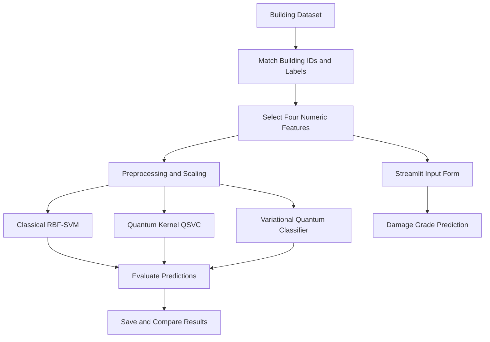

# Q-RESQ — Quantum Machine Learning-Based Disaster Severity Prediction

**Team:** Qubix
**Team ID:** VTU-QFF-HC-0177
**Tier:** Online
**Event:** VTU-Qiskit Fall Fest 2026 Hackathon

Q-RESQ is a research prototype exploring classical and quantum machine-learning techniques for earthquake-related building damage classification. It combines a Streamlit application with experiments using Qiskit's Quantum Support Vector Classifier (QSVC) and Variational Quantum Classifier (VQC).

> **Safety notice:** This is an experimental prototype, not a certified structural-safety assessment or an operational emergency-response system. Never use its predictions alone to determine building occupancy, evacuation, or real emergency-resource allocation.

## Table of Contents

- Problem Statement
- Proposed Solution
- Implementation and Architecture
- Technology Stack
- Project Structure
- Dataset Setup
- Installation and Execution
- Model Evaluation
- Limitations and Future Work
- Team Members
- Demo and Submission
- References

## 1. Problem Statement

Disaster response requires timely information about the potential damage caused by earthquakes. This project explores how machine-learning models can classify building damage grades using selected building characteristics and how classical and quantum approaches compare on a small experimental dataset.

The broader Q-RESQ problem statement focuses on quantum machine learning for disaster severity prediction and intelligent emergency response using environmental, geographical, and population-related information.

**Current implementation scope:** The prototype predicts earthquake-related building damage grades from four structural features. It does not yet implement regional risk mapping, environmental-data integration, population analysis, or emergency-resource quantity prediction.

## 2. Proposed Solution

Q-RESQ provides an interactive web interface where users enter building characteristics and receive a damage-grade prediction from a classical machine-learning model.

Alongside the web application, the project includes quantum machine-learning experiments using Qiskit.

Key components:

- Interactive Streamlit prediction interface.
- Classical RBF Support Vector Machine (SVM).
- Quantum-kernel QSVC experiment.
- Variational Quantum Classifier (VQC).
- CSV-based experiment outputs and model comparison.

The quantum experiments are exploratory. The current results do not demonstrate quantum advantage.

## 3. Implementation and Architecture



### Quantum Machine Learning

**QSVC**

- Uses Qiskit Machine Learning's `FidelityQuantumKernel`.
- Uses a four-feature ZZ quantum feature map.
- Compares quantum-kernel classification with a classical RBF-SVM.

**VQC**

- Uses a four-qubit ZZ feature map.
- Uses a `RealAmplitudes` variational ansatz.
- Uses `StatevectorSampler` and the COBYLA optimizer.
- Evaluates predictions on a small test subset.

**Classical model**

- Uses an RBF-kernel SVM in the Streamlit app.
- The app trains on a stratified subset of up to 1,200 examples to keep the demonstration lightweight.

## 4. Technology Stack

| Component                  | Technology              |
| -------------------------- | ----------------------- |
| Programming language       | Python 3.11+            |
| Quantum computing          | Qiskit                  |
| Quantum machine learning   | Qiskit Machine Learning |
| Classical machine learning | scikit-learn            |
| Data processing            | NumPy and pandas        |
| Web interface              | Streamlit               |
| Results                    | CSV                     |
| Development                | VS Code / PowerShell    |
| Version control            | Git and GitHub          |

## 5. Project Structure

```text
vtu-hc-qubix/
├── README.md
├── requirements.txt
├── .gitignore
├── src/
│   ├── app.py
│   ├── baseline.py
│   ├── compare_models.py
│   ├── quantum_model.py
│   └── vqc_model.py
└── results/
    ├── model_comparison.csv
    ├── quantum_comparison.csv
    └── vqc_comparison.csv
```

The dataset is not committed to this repository. Follow the instructions below to configure it locally.

## 6. Dataset Setup

The project expects these files:

- `data/train_values.csv`
- `data/train_labels.csv`

The files must share the `building_id` column. The labels file must contain `damage_grade`.

The expected file format matches the **Richter's Predictor: Modeling Earthquake Damage** dataset, which concerns building damage from the 2015 Gorkha earthquake in Nepal.

Dataset information: [https://www.drivendata.org/competitions/57/nepal-earthquake/](https://www.drivendata.org/competitions/57/nepal-earthquake/)

Obtain the dataset through its official page and follow its data-use terms. Place the required CSV files inside the local `data` directory. The repository's `.gitignore` excludes dataset CSV files, so they will not be included in a normal Git commit.

## 7. Installation and Execution

### Prerequisites

- Python 3.11 or newer
- Git
- The two required dataset CSV files

### Step 1 — Clone the repository

```powershell
git clone https://github.com/vtu-qiskit-fall-fest-2026/vtu-hc-qubix.git
cd vtu-hc-qubix
```

### Step 2 — Create and activate a virtual environment

```powershell
py -3.11 -m venv .venv
.\.venv\Scripts\Activate.ps1
```

### Step 3 — Install dependencies

```powershell
python -m pip install --upgrade pip
python -m pip install -r requirements.txt
```

### Step 4 — Configure the dataset

Create the `data` folder if necessary and place `train_values.csv` and `train_labels.csv` inside it.

### Step 5 — Launch the application

```powershell
python -m streamlit run src/app.py
```

Open the local URL printed by Streamlit in your browser. Enter the building details and select **Predict Damage Grade**.

### Optional — Run model experiments

Run these commands from the repository root after installing dependencies and setting up the dataset:

```powershell
python src/baseline.py
python src/quantum_model.py
python src/vqc_model.py
python src/compare_models.py
```

Quantum simulations may take longer than the classical application. Running the experiment scripts can overwrite the CSV result files.

## 8. Model Evaluation

The committed `results/model_comparison.csv` contains these results from a 30-sample test set.

| Model             | Accuracy | Balanced Accuracy | Macro F1 | Test Samples |
| ----------------- | -------: | ----------------: | -------: | -----------: |
| Classical RBF-SVM |   56.67% |            51.63% |   45.48% |           30 |
| Quantum QSVC      |   50.00% |            33.53% |   31.58% |           30 |
| Quantum VQC       |   36.67% |            39.87% |   25.98% |           30 |

These results are preliminary and based on a small test set. They do not establish that quantum models outperform classical models.

The Streamlit application's displayed SVM accuracy uses a separate data split and must not be compared directly with the 30-sample experiment results.

## 9. Limitations and Future Work

### Current limitations

- Only four building characteristics are used in the interactive application.
- The current model classifies dataset damage grades; it does not certify structural safety.
- Geographic risk mapping and emergency-resource quantity prediction are not implemented.
- Quantum models are evaluated on small simulator-based experiments.
- The dataset must be obtained separately.
- The results do not demonstrate quantum advantage.

### Future work

- Evaluate all models on a larger, consistently defined test set.
- Explore additional permitted environmental, geographic, and population-related features.
- Investigate regional risk visualization using validated data.
- Explore resource-planning support after suitable validation.
- Improve automated testing, reproducibility, and model documentation.

## 10. Team Members

| Name                    | GitHub                                                             | Contribution                          |
| ----------------------- | ------------------------------------------------------------------ | ------------------------------------- |
| Madhuri Seetha Thondapu | [@madhuriseetha2006-web](https://github.com/madhuriseetha2006-web) | Project development and documentation |
| Takkellapati Pooja      | Add GitHub username                                                | Add actual contribution               |
| Rakurthi Harshitha      | Add GitHub username                                                | Add actual contribution               |


Before final submission, replace the remaining placeholders with the team's confirmed names, GitHub usernames, and contributions. Do not publish guessed details.

## 11. Demo and Submission

- **GitHub repository:** [https://github.com/vtu-qiskit-fall-fest-2026/vtu-hc-qubix](https://github.com/vtu-qiskit-fall-fest-2026/vtu-hc-qubix)
- **Demo video:** Add the actual YouTube URL after uploading the final demonstration.
- **Hackathon submission:** Submit the required PPT and links through the official portal according to the event guidelines.

## 12. References

- [Qiskit documentation](https://docs.quantum.ibm.com/)
- [Qiskit Machine Learning documentation](https://qiskit-community.github.io/qiskit-machine-learning/)
- [Streamlit documentation](https://docs.streamlit.io/)
- [Richter's Predictor: Modeling Earthquake Damage](https://www.drivendata.org/competitions/57/nepal-earthquake/)

---

**Qubix · VTU-QFF-HC-0177 · Online · VTU-Qiskit Fall Fest 2026**
